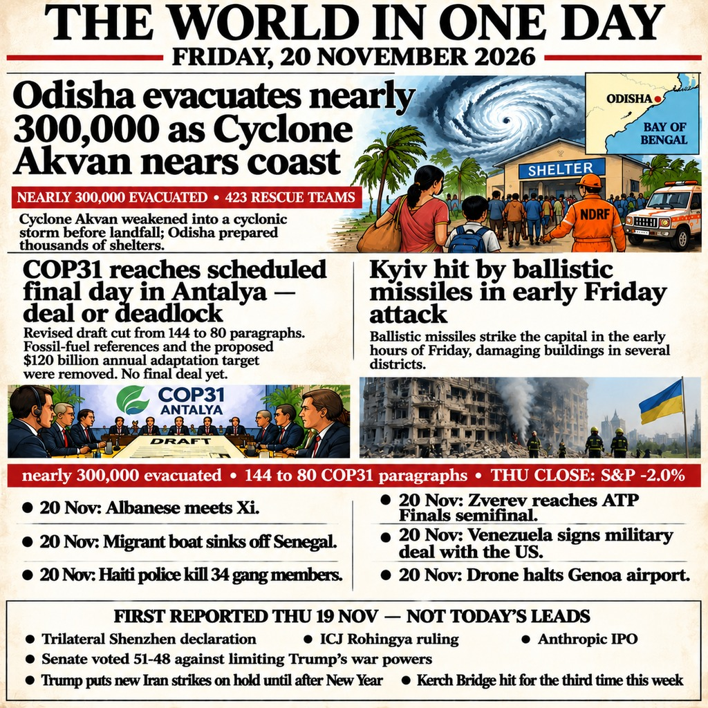

# The World in One Day — 20 November 2026

[](https://make.fun/bounty/news-image-20261120?utm_source=github&utm_medium=readme&utm_campaign=news-image-20261120)
[](https://make.fun/bounty/news-image-20261120/leaderboard?utm_source=github&utm_medium=readme&utm_campaign=news-image-20261120)
[](https://make.fun/bounty/news-image-20261120?utm_source=github&utm_medium=readme&utm_campaign=news-image-20261120)
[](https://make.fun/bounty/news-image-20261120)

A colorful illustrated newspaper front page with the masthead **THE WORLD IN ONE DAY — Friday, 20 November 2026**. The dated headlines, pictures, short briefs, regional map, and red numbers strip put the day's world-news roundup into one image.



## What the image shows

### Three lead stories

- **Cyclone Akvan, Odisha:** nearly 300,000 people evacuated as the storm nears the coast. The caption states that Akvan weakened into a cyclonic storm before landfall; shelters and 423 rescue teams accompany the evacuation story. An inset map locates Odisha and the Bay of Bengal.
- **COP31, Antalya:** the climate conference reaches its scheduled final day, with “deal or deadlock” still unresolved. The revised draft shrank from 144 to 80 paragraphs, removing fossil-fuel references and the proposed $120 billion annual adaptation target. The panel explicitly says **“No final deal yet.”**
- **Kyiv:** ballistic missiles hit the capital in an early Friday attack, damaging buildings in several districts. The illustration shows damaged buildings, emergency responders, and the Ukrainian flag.

### Six briefs dated 20 November

- Albanese meets Xi.
- A migrant boat sinks off Senegal.
- Haiti police kill 34 gang members.
- Zverev reaches the ATP Finals semifinal.
- Venezuela signs a military deal with the US.
- A drone halts Genoa airport.

### Earlier reports, explicitly dated

The box **“FIRST REPORTED THU 19 NOV — NOT TODAY'S LEADS”** lists the trilateral Shenzhen declaration; the ICJ Rohingya ruling; Anthropic's IPO; the Senate's 51–48 vote against limiting Trump's war powers; Trump putting new Iran strikes on hold until after New Year; and a third hit on the Kerch Bridge that week.

The red numbers strip repeats the nearly 300,000 evacuations and the COP31 draft's reduction from 144 to 80 paragraphs. Its **“THU CLOSE: S&P −2.0%”** label identifies the market figure as Thursday's close.

## Competition

Entry for [make.fun's **news-image-20261120** bounty](https://make.fun/bounty/news-image-20261120): **“Sum up 20 November's world news in one image.”**

- **Prize pool:** $250; free entry; top 50 paid.
- **Deadline:** 22 November 2026, 07:00 WIB (UTC+7).
- **Judge:** AI pairwise judge, `glm-5.3-flash`, with no news feed.
- **Criteria, in order:** one day's news with that day's names, recognizable events, and a visible date; story selection and breadth; clarity from the image alone; faithful reporting without treating hype as fact; craft and legibility at about 300 pixels.

## Run

Requires Node.js 22.18 or newer for native TypeScript execution. There are no package dependencies.

```sh
npm start
# Or choose an output directory:
MAKEFUN_OUTPUT_DIR=/tmp/world-news-output node main.ts
```

`main.ts` resolves `entry.png` relative to its own location using `fileURLToPath(import.meta.url)`, copies it byte-for-byte to `${MAKEFUN_OUTPUT_DIR}/entry.png` (default `/output/entry.png`), and validates the copied JPEG's dimensions as exactly **1024×1024** before printing a success message. It makes no network calls and also works when invoked by absolute script path from another working directory.

The supplied `entry.png` contains JPEG data despite its filename: **466,491 bytes**, **1024×1024**. Its SHA-256 is:

```text
5dee6307698df3e9b929d6fa708c0f8c76167014e284039ec51e5a258b84d7ec
```

## License

MIT — copyright © 2026 Ardian9712. See [LICENSE](LICENSE).

---

Built for make.fun. Referral link: [https://make.fun/r/p8atzycs](https://make.fun/r/p8atzycs).
